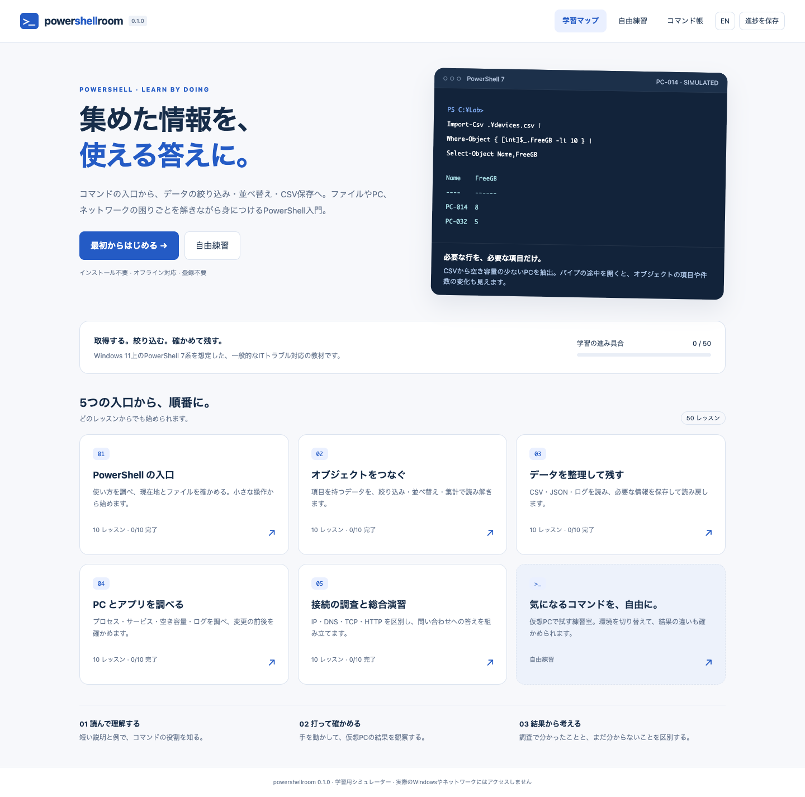

# powershellroom

PowerShell のオブジェクトとパイプラインを、日常の IT トラブルシューティングで学ぶ教材です。[windowsCLIroom](https://github.com/retiacole/windowsCLIroom) と並ぶ、room シリーズの日常 IT 操作を練習する教材です。短い説明と実習、3 段階のヒント、解答例、学習マップ、進捗保存を備えています。

**v0.1.0 · 5 コース・50 レッスン · 解釈問題 20 問 · 総合演習 3 件 · 日本語 / English**

PowerShell のインストールやアカウント登録は不要です。配布用 HTML を保存すれば、演習をオフラインでも進められます。

114 件のテストと、全 50 レッスン・12 通りの別解のブラウザー確認を実施しました。[確認記録](VALIDATION.md)を同梱しています。

[レビューガイド](REVIEW_GUIDE.md) · [変更記録](CHANGELOG.md) · [開発手順](CONTRIBUTING.md) · [公開・更新手順](PUBLISHING.md)

<details>
<summary>教材の画面を見る</summary>



</details>

## 開き方

[powershellroom.html](powershellroom.html) を保存してブラウザーで開きます。GitHub 上では HTML のファイル画面からダウンロードして開いてください。教材の利用に PowerShell のインストール、ログイン、サーバーの起動は不要です。単一 HTML に教材・画面・シミュレーターを含みます。

各レッスンは独立した仮想環境です。「やってみよう」に沿ってコマンドを入力し、出力を観察します。解釈問題がある場合は選択肢にも回答します。誤答には個別の説明を表示します。

「処理の流れ」を開くと、パイプの各段が受け取ったデータと出力、型、件数を確認できます。「オブジェクトの項目を見る」では、画面に表示した表の元になった項目を確認できます。値を絞り込む `Where-Object`、項目を選ぶ `Select-Object`、表示を整える `Format-Table` の違いを学びます。

## 学ぶこと

| コース | 内容 |
| --- | --- |
| PowerShell の入口 | コマンドの発見、ヘルプ、現在地、パス、読み書き、移動と名前変更 |
| オブジェクトをつなぐ | 型とプロパティ、抽出、比較、並べ替え、集計、変数、各オブジェクトからの項目抽出 |
| データを整理して残す | CSV の読み込みと数値変換、絞り込み、書き出し、JSON、報告用の一覧 |
| PC とアプリを調べる | プロセス、累積 CPU 時間、サービス、イベントログ、OS とディスク情報 |
| 接続の調査と総合演習 | IP・DNS・ICMP・TCP・HTTP の違い、REST の応答、根拠を集める調査と再確認 |

題材は一般的な IT サポートです。実際の端末に対する管理操作、リモート接続、ドメイン構築、セキュリティ製品の操作は行いません。

## 操作と保存

- **Enter**：実行。日本語変換を確定する Enter では実行しません。
- **↑ / ↓**：実行履歴。**Tab**：コマンド・パスの補完。
- **→**：完了後、入力欄が空なら次のレッスンへ。
- **この問題をリセット**：現在の問題のファイル・履歴・回答・ヒントを最初に戻します。他の問題の進捗と過去の完了記録は残します。
- **設定と学習データ**：進捗 JSON の書き出し・読み込み。ブラウザー内にも自動保存します。

日本語の課題・ヒント・見本・解答例はパスを `C:¥Lab`、英語は `C:\Lab` と表示します。見本は表示どおりに入力して実行できます。パス入力では `\`、`¥`、`￥`、`/` を受け付けます。これは教材の入力補助です。実機で別々の Unicode 文字が常に同じ扱いになるわけではありません。本文・検索文字列・URL 内の円記号は変えません。

保存先は `powershellroom.progress.v1` です。windowsCLIroom の進捗とは独立しています。ファイルを直接開いたときの自動保存の扱いはブラウザーにより異なります。学習記録を残したい場合は JSON に書き出してください。読めない既存データを検出した場合は、自動保存を止めて元データを保護します。

## 想定環境と再現範囲

基準は **Windows 11 上の PowerShell 7 系**です。Windows 標準の Windows PowerShell 5.1 とは別です。版は `$PSVersionTable` で確認する内容を扱います。NetTCPIP など Windows 固有のモジュールを含み、macOS / Linux の PowerShell で同じコマンドが使えるとは限りません。

JavaScript で対応範囲を定めた学習用シミュレーターです。実 PowerShell を実行するものではありません。PC-014、社内ドメイン、ファイル、IP、ログ、時刻は架空の固定データです。学習中に OS やネットワークにアクセスしません。参考資料のリンクは外部サイトです。

対応する書式は教材内の「コマンド帳」と `Get-Help` にあります。構文全体、任意のスクリプト、長い制御構文、リモート処理、モジュールの追加、認証、レジストリ編集は再現しません。未対応の入力は説明を表示します。

- パイプラインではプロパティと値を持つデータを渡します。画面上の表を文字列として切り貼りする実装ではありません。
- 変数への代入と参照、二重引用符でのスカラー・環境変数の補間、限定した `Where-Object` / `ForEach-Object` のスクリプトブロックを扱います。任意の式の評価には対応しません。
- `Where-Object` は単一の比較条件（必要に応じて `[int]` / `[double]`）、`ForEach-Object` は各オブジェクトの項目抽出に対応します。一般的なループや任意の処理ブロックは再現しません。
- `Sort-Object` / `Group-Object` は単一項目のみ、`Select-String` は文字列の検索に対応します。文字コードの指定は UTF-8 に限定しています。
- `Select-Object -First` / `-Last` で先頭・末尾の項目を選べます。`Get-CimInstance -Filter`、`(Get-Service Spooler).Status` のような括弧付き式は未対応です。
- サービスの既定表示は Status・Name・DisplayName です。StartType や、プロセスの Path・StartTime・Responding はオブジェクトに保持し、`Select-Object` / `Get-Member` で調べられます。`Get-Member` のメソッド一覧は一部を表示するだけで、メソッド呼び出しは再現しません。
- `ConvertTo-Json -Depth` は指定値の検査に対応しますが、深さによる項目の省略や警告は再現していません。
- `Import-Csv` の値は文字列です。数値として比較する演習では `[int]` で変換します。
- `Format-*` は表示用です。`Export-Csv` につなぐ場合は `Select-Object` を使います。表示用データを CSV に渡す操作は教材では説明付きで拒否します。
- 仮想 C / D ドライブのテキストファイルが対象です。UNC、実ファイル、任意のバイナリー、ファイル権限の完全再現は含みません。
- 状態変更は仮想ファイル、演習用 NotesApp、Spooler に限定しています。`-WhatIf` と実行を区別します。実機では権限・対象・影響の確認が必要です。
- HTTP は登録済みの架空の応答のみです。PowerShell 7 の `-SkipHttpErrorCheck` を扱い、通常の 503 エラーと区別します。TLS や認証の検証は行いません。
- 型名・表の表示・エラーメッセージは学習向けの簡略表現です。実機の表示を完全に再現するものではありません。

自由練習では、通常の PC、印刷サービス停止、DNS 設定不良、TCP 接続失敗、HTTP 503、ディスク容量不足を切り替えられます。変更はその練習室内だけに反映されます。

## 対応コマンド

51 種類のコマンド名に対応します。全オプションを再現するものではありません。具体的な書式は教材内の「コマンド帳」または `Get-Help` で確認できます。

| 用途 | コマンド |
| --- | --- |
| 発見・基本操作 | `Get-Command`、`Get-Help`、`Get-Alias`、`Get-Location`、`Set-Location`、`Write-Output`、`Clear-Host` |
| ファイル | `Get-ChildItem`、`Get-Item`、`Test-Path`、`Get-Content`、`Set-Content`、`Add-Content`、`New-Item`、`Copy-Item`、`Move-Item`、`Rename-Item`、`Remove-Item` |
| オブジェクトと表示 | `Get-Member`、`Select-Object`、`Where-Object`、`Sort-Object`、`Measure-Object`、`Group-Object`、`ForEach-Object`、`Format-Table`、`Format-List` |
| テキスト・CSV・JSON | `Out-File`、`Export-Csv`、`Import-Csv`、`ConvertTo-Json`、`ConvertFrom-Json`、`Select-String` |
| プロセス・サービス | `Get-Process`、`Stop-Process`、`Get-Service`、`Start-Service`、`Stop-Service`、`Restart-Service` |
| 端末情報とログ | `Get-CimInstance`、`Get-WinEvent` |
| IP・名前解決・接続 | `Get-NetIPConfiguration`、`Get-NetAdapter`、`Get-DnsClientServerAddress`、`Resolve-DnsName`、`Test-Connection`、`Test-NetConnection`、`Get-NetTCPConnection`、`Get-NetRoute` |
| HTTP・JSON 応答 | `Invoke-WebRequest`、`Invoke-RestMethod` |

`Get-CimInstance` は `Win32_OperatingSystem`・`Win32_LogicalDisk`・`Win32_ComputerSystem`、`Get-WinEvent` は System ログが対象です。PowerShell の共通パラメーターすべてに対応するわけではありません。

## 開発と確認

Node.js 22 以降を使います。教材本体の実行に Node.js は不要です。

```sh
npm ci
npm run build
npm test
npx playwright install chromium
npm run test:browser
```

インストール済みの Chrome で確認する場合は `PSR_BROWSER_CHANNEL=chrome npm run test:browser` を使えます。テストは独立したブラウザープロファイルで動きます。

ビルドは同じ内容の `powershellroom.html`、`docs/index.html`、`docs/powershellroom.html` を生成します。GitHub Pages の公開元には `main` ブランチの `/docs` を使用します。

| ファイル | 役割 |
| --- | --- |
| `src/ui.html` / `src/style.css` / `src/app.js` | 画面・入力・進捗操作 |
| `src/shell.js` | 構文解析、オブジェクト、仮想ファイル、変数 |
| `src/network.js` | PC・サービス・ネットワーク・HTTP の架空モデル |
| `src/data.js` | 日英の説明、課題、解答例、解釈問題 |
| `src/engine.js` | 採点と進捗の検証 |
| `tests/` | シミュレーター・教材・保存・ブラウザーの確認 |

実機の PowerShell 7 / Windows 11 との手動比較は未実施です。初版のレビューでは、対応範囲内の代表操作と教材の説明を実機でも照合してください。

## 参考資料

- [Microsoft Learn — PowerShell のパイプライン](https://learn.microsoft.com/en-us/powershell/module/microsoft.powershell.core/about/about_pipelines)
- [Microsoft Learn — Export-Csv](https://learn.microsoft.com/en-us/powershell/module/microsoft.powershell.utility/export-csv)
- [Microsoft Learn — Test-NetConnection](https://learn.microsoft.com/en-us/powershell/module/nettcpip/test-netconnection)
- [Microsoft Learn — Invoke-WebRequest](https://learn.microsoft.com/en-us/powershell/module/microsoft.powershell.utility/invoke-webrequest)
- [Microsoft Learn — Windows PowerShell 5.1 と PowerShell 7 の違い](https://learn.microsoft.com/en-us/powershell/scripting/whats-new/differences-from-windows-powershell)

## English

Download the HTML and open it locally to practice offline, with no PowerShell installation or account required.

**powershellroom** is a Japanese/English learning simulator for PowerShell 7 on Windows 11, with 50 independent lessons across five tracks. Alongside [windowsCLIroom](https://github.com/retiacole/windowsCLIroom), it offers practice in everyday IT tasks within the room series. Open `powershellroom.html` in a browser to use it offline.

Learn command discovery, files, objects, filtering, sorting, variables, CSV/JSON reports, process and service inspection, and DNS/TCP/HTTP troubleshooting. The pipeline trace shows object types, counts, and properties. Questions ask learners to distinguish evidence from assumptions.

Use **Reset this lesson** to restore its environment while retaining other lessons and past completion records. Progress is stored independently from windowsCLIroom; export/import a JSON backup from **Settings & progress**. Japanese examples show yen path separators and English examples show backslashes. Typed command drafts and previous output survive language changes.

Only the documented command subset is simulated. All files, computers and network responses are fictional; no commands run on your actual OS and no real connections are made. PowerShell 7 differs from Windows PowerShell 5.1, and Windows-specific network modules are not portable to every platform. Manual comparison against a real Windows/PowerShell environment is still pending.

The simulator supports single-condition filters, property projection in `ForEach-Object`, first/last item selection, single-property sorting/grouping, literal text search, and UTF-8 encoding. `Get-CimInstance -Filter` and parenthesized expressions such as `(Get-Service Spooler).Status` are unsupported. `Get-Member` lists a small subset of methods for discovery; invoking methods is unsupported. `ConvertTo-Json -Depth` validates the argument but does not reproduce depth truncation or warnings. See the [review guide](REVIEW_GUIDE.md), [validation record](VALIDATION.md), and [contribution guide](CONTRIBUTING.md) for details.

MIT License. See [LICENSE](LICENSE). The original windowsCLIroom copyright notice is retained.
